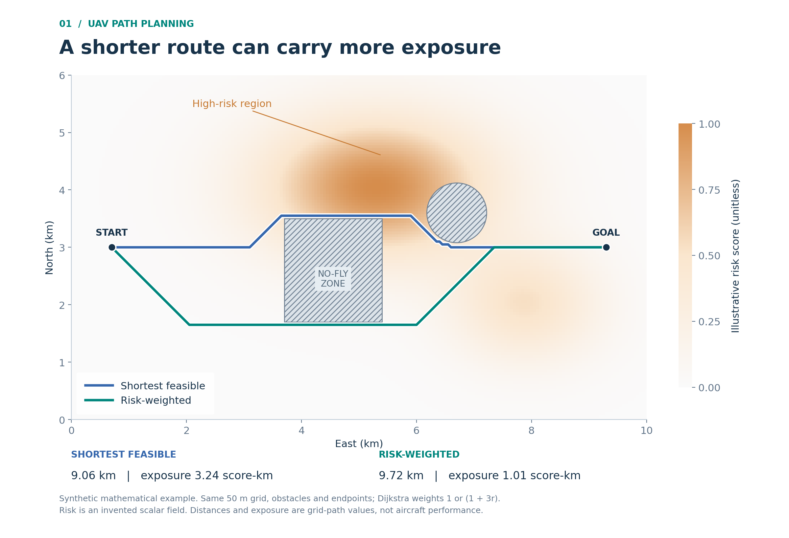
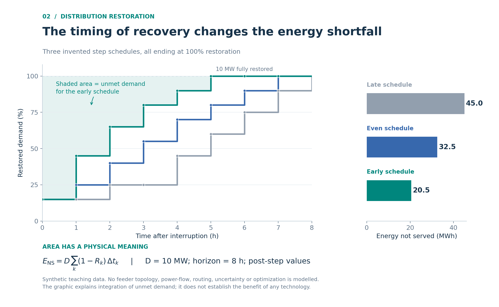

# 科研辅助 Skill · Research Assistant Skills

一组用于科研阅读和知识积累的中文代理技能。把论文读懂、把概念讲清，再将内容组织成可以持续复用的本地笔记。

当前包含四个技能，后续可在 `skills/` 下继续增加其他科研工作流。

| 技能 | 用途 |
|---|---|
| [chc-vault-notes](skills/chc-vault-notes/SKILL.md) | 创建、改写和审校中文学习笔记；有助理解时联网查找有明确许可的图片，保存为本地附件并就近讲解。适配实际知识库结构，不要求使用 CHC 知识库。 |
| [mineru-paper-reading](skills/mineru-paper-reading/SKILL.md) | 基于已有 MinerU 材料和源 PDF 完成全文精读、全部公式讲解、独立知识积累、续写和直接审校。 |
| [scientific-visualization](skills/scientific-visualization/SKILL.md) | 根据图要说明的问题选择视觉编码、配色、注释和版式，用 Python / Matplotlib 生成并检查科研图。包含 Rougier 著作的提炼与改编，知识文本按 CC BY-NC-SA 4.0 使用。 |
| [stop-ai-slop-zh](skills/stop-ai-slop-zh/SKILL.md) | 精简中文科研笔记中的套话、重复解释和无关评价，保留技术内容、适用条件及证据强度。基于 VincentOld/stop-slop-zh 的科研保真改编，也可独立润色已有文字。 |

各技能都可以单独使用；两个笔记技能可共享目录和写作偏好，绘图技能可以按任务辅助它们。详细文风规则独立放在 `stop-ai-slop-zh` 中维护。

## 先看实际效果

- [联网配图笔记](examples/web-image-note/README.md)：本地保存 Wikimedia Commons 的开放许可图，图旁说明作者、原始页面、许可及阅读方法。
- [论文精读展示](examples/mineru-paper-reading/README.md)：14 篇既有精读笔记、20 篇独立知识笔记和 4 张原创教学图，保留公式讲解、疑点及相互链接。
- [科研绘图展示](examples/scientific-visualization/README.md)：两张不同类型的原创图，附可重跑源码、数据及 PNG / SVG / PDF。图中数据为合成示例。





真实论文展示使用的是 *Improving Resiliency of Cyber-Dependent Power Distribution Network Using UAVs*（[DOI](https://doi.org/10.1109/TSTE.2024.3424242)）。公开笔记来自已有精读产出，本次整理为可浏览示例。其 PDF 明示 IEEE 再分发限制，因此**公开仓库不含该论文的源 PDF、MinerU 全文转写、含原文的解析 JSON 或原论文截图**；[材料清单与本地使用说明](examples/mineru-paper-reading/source/README.md)记录了输入结构和取得材料后的用法。论文笔记中的原图位置有明确说明，未伪造图片附件。

## 使用前需要什么

- 能加载 `SKILL.md` 的代理，例如 Codex；其他支持相同技能格式的工具也可以读取其中的工作流，调用方式按对应工具处理。
- 能访问本次资料，并在目标工作区读写文件。核对论文公式、图片和版面时，还需要查看图片及源 PDF 页面的能力。
- 使用论文精读技能时，提供**已经生成的 MinerU 解析目录**；建议同时提供源 PDF。本仓库不包含 MinerU 安装程序、解析服务或论文原文。
- 联网配图需要代理具有搜索、下载和看图能力；不联网或没有合适图片时，继续完成笔记，并按需要自绘或说明缺口。执行 Python 绘图脚本需要对应环境中的 NumPy / Matplotlib 等依赖，技能本身不自动安装依赖。

技能本体是 Markdown 指令和参考文件，不绑定作者电脑、某个盘符、Python 虚拟环境、API 密钥或特定模型。绘图、PDF 等其他技能可以辅助任务，但不是必须一起安装的依赖。

## 安装

### 在 Codex 中安装

如果环境提供 `skill-installer`，可以直接发送：

```text
请使用 $skill-installer，从 https://github.com/Croix-Kongcheng/research-assistant-skills
安装 skills/chc-vault-notes、skills/mineru-paper-reading、skills/scientific-visualization
和 skills/stop-ai-slop-zh。
```

按需要安装其中一个或几个即可，不要求安装整套。

也可以下载或克隆本仓库，将需要的**完整技能文件夹**复制到 Codex 能发现的技能位置。例如当前项目的 `.agents/skills/`：

```text
你的工作区/
└─ .agents/
   └─ skills/
      ├─ chc-vault-notes/
      │  ├─ SKILL.md
      │  └─ ...
      ├─ mineru-paper-reading/
      │  ├─ SKILL.md
      │  └─ ...
      ├─ scientific-visualization/
      │  ├─ SKILL.md
      │  └─ ...
      └─ stop-ai-slop-zh/
         ├─ SKILL.md
         └─ ...
```

不要只复制 `SKILL.md`；`references/` 中有完整要求。如果已经安装过同名个人定制版，请先选择要使用的版本与安装范围，避免直接覆盖自己的规则。安装位置和发现行为见 [Codex 官方技能文档](https://learn.chatgpt.com/docs/build-skills)。

### 其他代理

按照相应工具的技能安装方式保留文件夹结构。如果工具不自动发现技能，可以让它读取对应 `SKILL.md` 及其中要求的参考文件。是否能够完成本地落盘、PDF 页图核对和图像检查，取决于该工具实际开放的能力。

## 第一次使用

先打开自己的笔记工作区，或在对话中给出目标位置。**不需要复制作者的知识库目录。**

### 整理普通笔记

```text
请用 $chc-vault-notes，把这份资料整理成容易理解的中文笔记。
知识库根目录：<自己的知识库或笔记工作区路径>
资料位置：<本次资料路径>
保存到：<目标文件或目录>
写法：简洁自然，保留关键公式、图片、条件和操作步骤。
合适的话联网找有明确许可的解释图，下载到附件目录，图旁说明看哪里及图片来源。
```

### 全文精读论文

```text
请用 $mineru-paper-reading 精读这篇论文，完成整套论文笔记和可复用知识笔记。
MinerU 解析目录：<本次解析材料目录>
源 PDF：<源 PDF 路径；若已在材料目录内可省略>
知识库根目录：<自己的知识库或笔记工作区路径>
研究课题：<本次研究课题，可省略>
读者背景：<自己已有的知识基础，可省略>
```

可以额外指定精读根目录，或指定本篇论文的完整目录；说明是哪一种，避免多套一层文件夹。未指定课题位置时，根据论文主要研究问题、实际课题目录和已有同篇笔记确定保存位置，不按作者原来的研究方向分类。

### 中断续写与审校

```text
请用 $mineru-paper-reading 继续上次的精读任务。
MinerU 解析目录：<材料目录>
知识库根目录：<自己的知识库路径>
已有论文笔记目录：<已有本篇论文目录>
先核对原文、实际文件和完成范围，再从未完成处继续，保留已有批注和疑问。
```

```text
请用 $mineru-paper-reading 审校并直接修订这套论文精读及相关知识笔记。
MinerU 解析目录：<材料目录>
知识库根目录：<自己的知识库路径>
论文笔记目录：<已有本篇论文目录>
对照源 PDF 检查正文、公式、图表和疑点，修正确定错误、补齐缺口并修复链接。
```

### 精简已有文字

两个笔记技能完成内容整理和事实核对后，默认读取环境中可用的 `stop-ai-slop-zh` 及相关参考，精简正文表达，再检查技术信息与笔记结构是否保留。用户可以明确要求“只整理内容，不做文风润色”。没有安装该技能时，按主技能已有写作规则完成任务，不中断、不自动安装，也不声称已经调用。

单独改写已有文字时可以发送：

```text
请用 $stop-ai-slop-zh 润色 <笔记位置或粘贴的文字>。
只处理表达，删掉套话、重复解释和无关评价。
保留原意、技术术语、公式、代码、数值、单位、条件、证据强度和未解决问题，
以及引用、链接、图片、导航、元数据和必要的解释。
不要补造数据、案例或个人经历；给出改写稿和影响理解的主要改动。
```

这套改编用于编辑中文表达，不检测文本作者身份，也不保证绕过 AI 检测。五维评分仅作可选的主观参考，不以分数替代科学内容核对。

## 适配自己的目录与写法

直接在对话中说明即可；经常使用时，也可以将 [配置示例](examples/research-skills.example.yaml) 复制到自己的目标工作区，命名为 `research-skills.yaml`。

配置可指定论文、独立知识、图片、索引位置，以及语言、自然或正式文风、读者背景、本地时区和链接格式。**用户本次要求优先，其次是配置，再其次是实际已有结构。** 没有配置且目标是明确的空白工作区时，才采用简洁的备用目录。

详细字段和路径解析规则见 [工作区配置](docs/configuration.md)。配置只在使用者自己的工作区生效，不需要修改技能文件。

### 绘制科研图

```text
请用 $scientific-visualization，把我的数据画成适合论文阅读的图。
数据：<文件位置及各列含义>
想说明：<比较、趋势或机制>
用途：<论文、汇报或学习笔记；有目标尺寸时注明>
输出：PNG 和可编辑的 SVG，并保留生成脚本。
```

没有真实数据而只想看样式时，明确要求合成示例，并在图及数据文件里标注。

## 输出约定

- 普通知识按概念和主题复用：先用别名、中英文名、缩写和正文查库，已有同概念笔记就直接引用，真实缺口补原篇，确无对应才新建；论文专题按本篇实际内容组织，并保留总览和前后篇导航。
- 论文精读及知识笔记都主动使用有助理解的图，默认少用 Mermaid。先复用原图或附件，操作说明用真实截图；本地不足且允许联网时核验来源与许可后取图。需要自绘时优先调用可用且适合的 `scientific-visualization`，实际导出、看图并就近嵌入。Mermaid 只在明确要求或简单流程 / 时序确有优势时少量使用；不要求额外安装技能，不设图数或调用次数，不用装饰图代替讲解。
- 正文实质段落、全部公式与符号、关键图表、算法、假设和限制都属于论文精读范围。篇数服从内容，不固定模板和数量。
- 原文事实、解释补充、自绘示意、假设数据和待核实疑点要能区分。缺少源 PDF 或看图能力时，明确哪些部分尚未完成原文核验。
- 普通笔记与论文笔记默认精简套话和重复内容；技术推导、独立条件、必要设问与结构继续保留。表达润色不替代全文精读，也不加强尚未确认的结论。
- 每篇新笔记最底部记录真实生成时间、时区和实际模型；更新旧笔记保留历史信息，并另记更新时间与模型。
- 文件和链接检查、全文理解、作者代码复现及真实实验验证分别报告，只声明实际做过的工作。

## 开发与继续扩展

仓库布局：

```text
skills/             可单独安装的技能
docs/               配置与验证说明
examples/           配置、联网配图、论文笔记与科研绘图展示
scripts/            仓库结构和可移植性校验
```

新增技能和更新流程见 [贡献与维护](CONTRIBUTING.md)。校验方式：

```bash
python -m pip install -r requirements-dev.txt
python scripts/validate_skills.py
```

这里的 Python 依赖仅用于仓库维护校验，不是使用技能的必需运行环境。实际验证范围见 [验证记录](docs/validation.md)。

## 许可

除另有标注的文件外，本仓库原创技能和文档采用 [MIT License](LICENSE)。`stop-ai-slop-zh` 保留上游 MIT 许可与文森（Wen Sen）署名；`scientific-visualization` 的改编知识文本采用 CC BY-NC-SA 4.0，其代码使用单独声明的 BSD 许可；联网配图示例中的第三方图保留原许可。详见 [第三方来源与许可](THIRD_PARTY_NOTICES.md)。论文及其他外部材料的权利不因本仓库的 MIT 许可而改变。
