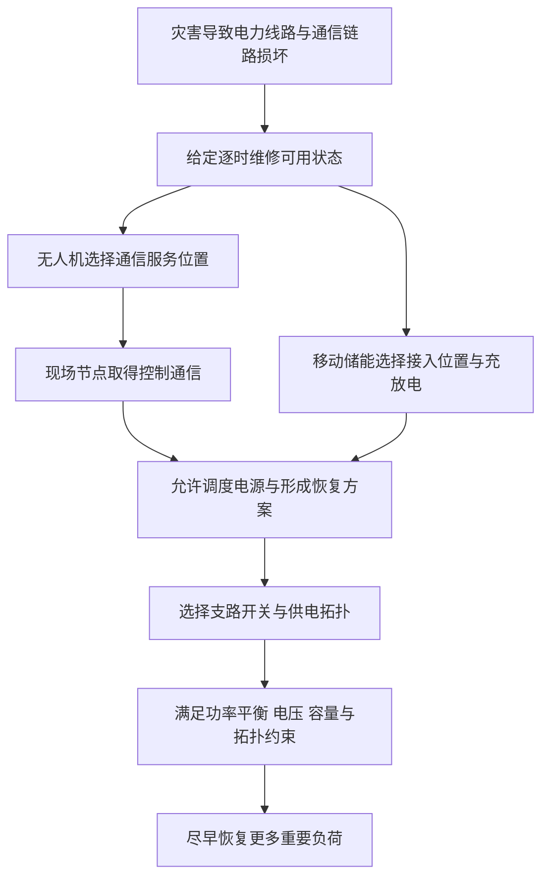

# 利用无人机提升依赖通信的配电网韧性：精读入口

这篇论文研究一个容易被忽略的问题：**灾后有电源、有开关、有移动储能，还不等于这些资源能被有效调度；通信断了，控制指令可能根本送不到。** 作者让无人机临时提供无线通信，再联合安排配电网重构和移动储能，以尽早恢复负荷。

本套笔记按“逐章、逐个正文段落、逐个编号公式”展开。正文中的数学符号使用 LaTeX；原文的 75 个编号公式保留原编号。需要补充代数步骤或反例时，明确标为“教学补充”，不把补充内容写成作者已经证明的结论。

## 论文与材料

| 项目   | 信息                                                                            |
| ---- | ----------------------------------------------------------------------------- |
| 原题   | Improving Resiliency of Cyber-Dependent Power Distribution Network Using UAVs |
| 中文理解 | 利用无人机提升依赖通信的配电网韧性                                                             |
| 作者   | G N V Mohan、Chandrashekhar N. Bhende、Yash Raghuwanshi                         |
| 刊物   | IEEE Transactions on Sustainable Energy，2024 年，第 15 卷第 4 期，2472–2485 页        |
| DOI  | [10.1109/TSTE.2024.3424242](https://doi.org/10.1109/TSTE.2024.3424242)        |
| 本次依据 | 用户提供的源 PDF、MinerU 的 `full.md` 和结构化解析；公式、表格及疑点回查源 PDF                          |

[论文官方入口](https://doi.org/10.1109/TSTE.2024.3424242)；[原始材料说明、文件清单与本地导入](../source/README.md)。公开仓库未附原论文 PDF、MinerU 全文及第三方原图。

笔记中的“PDF 第几页”从文件第一页计数；对应刊物页码为 PDF 页码加 2471。例如 PDF 第 8 页就是刊物第 2479 页。段落按 PDF 的正文自然段划分，跨栏、跨页的同一段合并说明；段首英文短语仅用于定位，不作为全文翻译。图注、表格和符号表单独解释，参考文献逐条说明在本文中的作用。页眉、许可页脚等不当成研究正文。

## 遇到基础概念，先去哪里补

读到陌生概念时，可以去 [知识积累](../knowledge/README.md) 找。这里补出的 20 个知识点按主题独立存放，以后读别的论文也继续往里面补；各专题用到这些概念的地方已经加了双链。

当前最容易卡住的三个入口是 [MILP 是什么](../knowledge/LP%E3%80%81MILP%E4%B8%8EMINLP.md)、[为什么需要大常数](../knowledge/%E5%A4%A7%E5%B8%B8%E6%95%B0M%E4%B8%8E%E6%9D%A1%E4%BB%B6%E7%BA%A6%E6%9D%9F.md)、[商品流是什么](../knowledge/%E7%BD%91%E7%BB%9C%E6%B5%81%E4%B8%8E%E6%B5%81%E5%AE%88%E6%81%92.md)；理解流守恒后，再读 [虚拟商品流如何证明连通](../knowledge/%E5%8D%95%E5%95%86%E5%93%81%E6%B5%81%E4%B8%8E%E8%BF%9E%E9%80%9A%E6%80%A7%E5%BB%BA%E6%A8%A1.md)。

## 阅读地图

| 笔记 | 对应原文 | 读完要弄清楚什么 |
|---|---|---|
| [01.摘要引言与恢复框架](01.%E6%91%98%E8%A6%81%E5%BC%95%E8%A8%80%E4%B8%8E%E6%81%A2%E5%A4%8D%E6%A1%86%E6%9E%B6.md) | 摘要、关键词、I、II | 作者为什么研究通信恢复，三个资源各做什么 |
| [02.符号总表与建模约定](02.%E7%AC%A6%E5%8F%B7%E6%80%BB%E8%A1%A8%E4%B8%8E%E5%BB%BA%E6%A8%A1%E7%BA%A6%E5%AE%9A.md) | Nomenclature 及正文补充符号 | 上下标、集合、单位、二元状态和功率方向 |
| [03.目标函数与潮流约束](03.%E7%9B%AE%E6%A0%87%E5%87%BD%E6%95%B0%E4%B8%8E%E6%BD%AE%E6%B5%81%E7%BA%A6%E6%9D%9F.md) | III 总起、III-A，式（1）—（14） | 什么叫恢复得好，以及电力如何平衡 |
| [04.辐射状拓扑与虚拟潮流](04.%E8%BE%90%E5%B0%84%E7%8A%B6%E6%8B%93%E6%89%91%E4%B8%8E%E8%99%9A%E6%8B%9F%E6%BD%AE%E6%B5%81.md) | III-B，式（15）—（21） | 为什么要树状结构，虚拟流怎样检查连通 |
| [05.MESS路径与充放电调度](05.MESS%E8%B7%AF%E5%BE%84%E4%B8%8E%E5%85%85%E6%94%BE%E7%94%B5%E8%B0%83%E5%BA%A6.md) | III-C，式（22）—（33） | 储能在哪里、何时能到、如何进出电量 |
| [06.通信依赖与路径连通表达](06.%E9%80%9A%E4%BF%A1%E4%BE%9D%E8%B5%96%E4%B8%8E%E8%B7%AF%E5%BE%84%E8%BF%9E%E9%80%9A%E8%A1%A8%E8%BE%BE.md) | III-D，式（34）—（35） | 通信可用性怎样限制电源调度 |
| [07.UAV路径与能量调度](07.UAV%E8%B7%AF%E5%BE%84%E4%B8%8E%E8%83%BD%E9%87%8F%E8%B0%83%E5%BA%A6.md) | III-E，式（36）—（48） | 无人机位置、通信服务和电池之间的关系 |
| [08.平方电压与乘积线性化](08.%E5%B9%B3%E6%96%B9%E7%94%B5%E5%8E%8B%E4%B8%8E%E4%B9%98%E7%A7%AF%E7%BA%BF%E6%80%A7%E5%8C%96.md) | IV 前半，式（49）—（64） | 平方电压替换和二元乘积为何能线性化 |
| [09.通信商品流与最终MILP](09.%E9%80%9A%E4%BF%A1%E5%95%86%E5%93%81%E6%B5%81%E4%B8%8E%E6%9C%80%E7%BB%88MILP.md) | IV 后半，式（65）—（75） | 通信商品流、缺供惩罚和最终优化问题 |
| [10.IEEE33节点算例逐段精读](10.IEEE33%E8%8A%82%E7%82%B9%E7%AE%97%E4%BE%8B%E9%80%90%E6%AE%B5%E7%B2%BE%E8%AF%BB.md) | V 总起、V-A，图 2—6，表 I—VI | 资源怎样配合，恢复时间线怎样读 |
| [11.天气敏感性与方法对比](11.%E5%A4%A9%E6%B0%94%E6%95%8F%E6%84%9F%E6%80%A7%E4%B8%8E%E6%96%B9%E6%B3%95%E5%AF%B9%E6%AF%94.md) | V-B、V-C，图 7—9，表 VII—VIII | 对比支持什么结论，功率与能量怎样区分 |
| [12.IEEE123节点算例与结论](12.IEEE123%E8%8A%82%E7%82%B9%E7%AE%97%E4%BE%8B%E4%B8%8E%E7%BB%93%E8%AE%BA.md) | V-D、VI，图 10—13，表 IX | 更大系统的参数、恢复过程及结论边界 |
| [13.原文疑点与参考文献导读](13.%E5%8E%9F%E6%96%87%E7%96%91%E7%82%B9%E4%B8%8E%E5%8F%82%E8%80%83%E6%96%87%E7%8C%AE%E5%AF%BC%E8%AF%BB.md) | 全文交叉核对、References | 哪些地方不能直接照抄建模，引用各起什么作用 |

第一次读可按编号顺序。已经知道基本背景、想看模型时，从第 02 篇开始。遇到公式中的一个符号不认识，先回第 02 篇找；遇到“为什么这一项这样写”，回对应公式所在篇，而不是只看符号表。

## 先把全文主线接起来

这是根据论文整理的阅读示意。**无人机在这篇文章中的主要身份是通信资源；移动储能才是可以迁移的供电资源。** 图中是优化变量之间的依赖关系，不表示算法必须逐项贪心求解。作者的意图是联合优化这些选择。

## 三个阅读边界

1. **原式不等于已验证实现。** 论文没有随所给材料提供优化代码、完整输入数据和求解日志。本套笔记核对的是发表文本，未复现作者算例。
2. **解释与纠错分开。** 原文存在下标、时间端点、通信逻辑和结果图表不一致的问题。各篇先说明原式，再标出疑点；教学修正不是作者代码的真实实现。
3. **仿真结论不等于实机能力。** 算例按小时安排候选节点间移动，没有给出连续飞行轨迹、避障、无线信道和完整飞行能耗模型。

原有 06MILP算法（关联资料未随此示例收录） 保留模型概念的简记，并已补上独立基础笔记入口。特别要注意：正确的平方电压替换方向是 $U_{i,t}=V_{i,t}^{2}$，不是把已经线性的 $U_{i,t}$ 再换成 $V_{i,t}^{2}$。

原版精读曾附论文的 13 幅图（拆成 19 个图片文件）及 2 张原公式裁剪图。**公开示例省略这 21 张第三方图像**，在原位置留下明确提示、图号 / 公式号及 PDF 页码；另提供 4 张原创教学示意图。原始材料情况见 [来源说明](../source/README.md)。

---

[开始阅读](01.%E6%91%98%E8%A6%81%E5%BC%95%E8%A8%80%E4%B8%8E%E6%81%A2%E5%A4%8D%E6%A1%86%E6%9E%B6.md)

---

生成时间：未知（原笔记未记录，不能从文件时间倒推）。

生成模型：未知（原笔记未记录）。

更新时间：2026-10-25 21:56:08 (Asia/Shanghai, UTC+08:00)；本次仅做公开副本与链接适配，未重新执行全文精读。

更新模型：GPT-6（会话声明的模型系列；具体模型 ID 未提供）。
