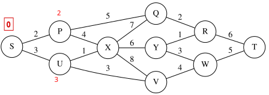

# Dijkstra：为什么“暂定距离”还会变？

这是 `chc-vault-notes` 联网找图功能的实际示例：先核对公开来源与许可，再把图片保存到本地，接到解释附近。

Dijkstra 解决的是：从起点出发，怎样让沿途边权之和最小？这里把边权理解成统一口径的路程或代价。**它适用于非负边权；“最短”不等于经过的边最少。** 算法每次选暂定距离最小、尚未确定的节点，确定它的最短距离，再尝试改进相邻节点的记录。[NetworkX 官方说明](https://networkx.org/documentation/stable/reference/algorithms/shortest_paths.html)

图：**Dijkstra algorithm 3.svg**，作者 [Willprice](https://commons.wikimedia.org/wiki/User:Willprice)，来自 [Wikimedia Commons 原始发布页](https://commons.wikimedia.org/wiki/File:Dijkstra_algorithm_3.svg)，采用 [CC BY-SA 3.0](https://creativecommons.org/licenses/by-sa/3.0/)；SVG 原图未作改动，未裁剪、标注或重绘。另存有 [Commons 提供的 PNG 预览](attachments/Dijkstra_algorithm_3-preview.png)，同样原样保存。获取日期：2026-10-25。

先看左边：起点 $S$ 旁是红色的 $0$，与它相连的 $P$、$U$ 分别标了红色的 $2$、$3$。把它理解为刚从 $S$ 更新邻居的局部状态：已知到 $P$ 的代价是 $2$，到 $U$ 是 $3$，下一步先处理较小的 $P$。

沿 $S\to P\to X$，暂时得到 $d(X)=2+4=6$。但是，**“找到一条能到的路”还不代表已经找到最短路。** 随后处理 $U$，图中的 $U$ 到 $X$ 只要 $1$，于是 $S\to U\to X$ 的代价是 $3+1=4$，比 $6$ 更小，就把 $d(X)$ 改为 $4$。

这个更新叫“松弛”：

$$
d(v)\leftarrow\min\bigl(d(v),\ d(u)+w(u,v)\bigr).
$$

$d(v)$ 是当前记录的起点到节点 $v$ 的暂定代价，$w(u,v)$ 是边 $u$ 到 $v$ 的代价；尚未发现可达路径的节点先记为 $+\infty$。这个例子里，就是比较旧记录 $6$ 与新候选 $3+1$。非负边权保证：选出的最小暂定距离节点，一旦确定，就不必被后面绕来的路径推翻。

上面的 $6\to4$ 是依据图中边权做的局部手算，用来说明暂定值如何更新；本示例没有运行最短路代码，也没有把这张局部状态图当作到 $T$ 的完整求解记录。

图片和文字分开授权：外来 SVG 与 PNG 保留 **CC BY-SA 3.0**；本示例原创讲解文字遵循仓库的 MIT 许可。来源和下载文件校验值见 [provenance.json](provenance.json)。

---

生成时间：2026-10-25T21:55:32+08:00（Asia/Shanghai）

生成模型：未知（当前环境未提供可确认的模型标识）
